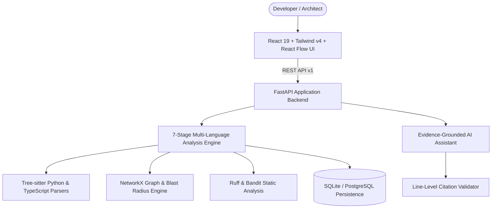

# DevMind AI
> **Understand any codebase. Trace every dependency. Change code with confidence.**

[](https://fastapi.tiangolo.com)
[](https://react.dev)
[](https://www.typescriptlang.org)
[](https://tailwindcss.com)
[](https://tree-sitter.github.io)
[](https://pytest.org)

DevMind AI is a codebase intelligence and software reverse-engineering platform that ingests software repositories, performs multi-stage static program analysis, builds verifiable dependency graphs, estimates the blast radius of proposed code changes, runs static security/quality checks, and provides an AI codebase assistant with verified line-level source code citations.

---

## Key Capabilities

- **Multi-Stage Analysis Engine**:
  - **Stage 1 (Discovery)**: Safe directory inventory, LOC counts, framework identification (FastAPI, React, Pytest, Django, etc.), entry-point detection.
  - **Stage 2 (Dual-Engine Parsing)**: Tree-sitter Python & TypeScript combined with Python AST for deep semantics, classes, functions, decorators, parameters, and return types.
  - **Stage 3 (Symbol Indexing)**: Stable UUID identification and transparent architectural layering (Presentation, API, Business, Data, Core, Test).
  - **Stage 4 (Dependency Extraction)**: Relative import resolution, static call tracking, inheritance mapping, and relationship categorization (`import`, `calls`, `inherits`, `contains`, `references`).
  - **Stage 5 (Graph Computation)**: NetworkX directed graph analysis, centrality scoring, and cycle detection using Tarjan's strongly connected components (SCC).
  - **Stage 6 (Lexical & Symbol Search)**: Fast search across symbols, file paths, full text, and regex patterns with 3-line context excerpts.
  - **Stage 7 (Architecture Reporting)**: Automated generation of exportable technical documentation.
- **Evidence-Grounded AI Assistant**:
  - Answers codebase architecture questions grounded in retrieved code fragments.
  - Validates every citation `[file:start-end]` against repository line boundaries to eliminate hallucinations.
  - Includes defensive prompt bounding to protect against prompt injection in repository files.
- **Change Impact Analyzer**:
  - Computes the direct and transitive blast radius of modifying any function, class, or file up to 5 graph hops.
  - Automatically identifies affected test suites requiring validation.
- **Security & Quality Analysis**:
  - Static evaluation via Ruff (linting) and Bandit (AST security).
  - Custom JavaScript/TypeScript AST checks for dangerous sinks (`eval`, `innerHTML`) and exposed secrets.
  - False-positive dismissal workflow with audit logging.
- **Revision Comparison**:
  - Diffs two commits or snapshots to detect added/removed symbols, modified signatures, and edge changes.

---

## System Architecture



---

## Quick Start Guide

### 1. Prerequisites
- **Python**: 3.11+
- **Node.js**: v20+
- **Git**

### 2. Local Setup

#### Backend:
```bash
cd backend
python -m venv .venv
# On Windows:
.\.venv\Scripts\activate
# On Linux/macOS:
# source .venv/bin/activate

pip install -r requirements.txt
python app/main.py
# Or run with uvicorn:
uvicorn app.main:app --host 127.0.0.1 --port 8088
```
Backend API will be running at `http://127.0.0.1:8088`.
Interactive OpenAPI Swagger docs: `http://127.0.0.1:8088/docs`.

#### Frontend:
```bash
cd frontend
npm install --legacy-peer-deps
npm run dev
```
Frontend will be running at `http://127.0.0.1:5173`.

### 3. Seed Demo Repository
To immediately explore a realistic multi-tier Python + TypeScript application:
```bash
python scripts/seed_demo_repo.py
```
This script generates a sample repository (`CloudVault Full-Stack`), registers it in DevMind AI, and executes the complete 7-stage analysis pipeline.

### 4. Running Automated Tests
```bash
cd backend
python -m pytest -v app/tests
```
All 10 test suites covering parsing, graph computation, dependency resolution, AI citation validation, and SSRF security pass cleanly.

---

## Docker Deployment

To launch the full stack with PostgreSQL (pgvector) and Redis:
```bash
docker-compose up --build -d
```
- Frontend UI: `http://localhost:3000`
- Backend API: `http://localhost:8088`
- API Documentation: `http://localhost:8088/docs`

---

## Documentation Index

- [Architecture Overview](docs/architecture.md)
- [Database Design & Data Model](docs/database-design.md)
- [Analysis Methodology](docs/analysis-methodology.md)
- [Security Model & Threat Defense](docs/security-model.md)
- [REST API Guide](docs/api-guide.md)

---

## License
MIT License. Built for codebase intelligence and program analysis.
