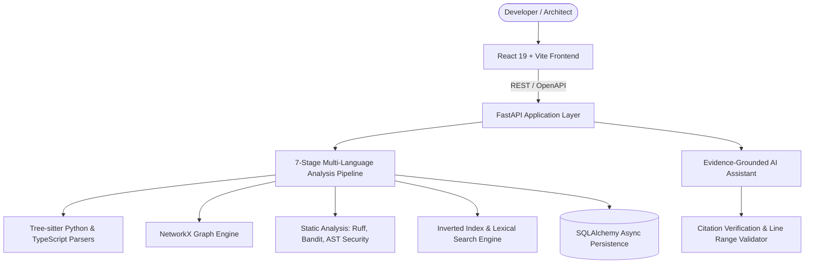

# DevMind AI: System Architecture

## Architectural Principles
DevMind AI is structured as a high-performance **modular monolith** with clean separation between code analysis, graph computation, retrieval-augmented intelligence, and interactive UI delivery.

## Layer Overview
1. **Frontend**: React 19, TypeScript, Vite, Tailwind CSS v4, React Router, TanStack Query, React Flow (`@xyflow/react`), Recharts.
2. **API Layer**: FastAPI under `/api/v1` with Pydantic V2 schemas, strict type safety, and OpenAPI documentation at `/docs`.
3. **Program Analysis Engine**:
   - Multi-stage pipeline: Discovery, Parsing, Indexing, Dependency Resolution, Architecture Inference, Security Checks, Reporting.
   - Dual-engine parsing: Tree-sitter for robust fault-tolerant parse trees combined with Python AST for deep semantics.
4. **Graph Engine**:
   - NetworkX directed graph representation (`DiGraph`).
   - Centrality metrics, strongly connected component (SCC) dependency cycle detection, forward and reverse reachability traversal (blast radius).
5. **AI Assistant**:
   - Evidence retrieval bounded by security isolation tags.
   - Deterministic offline Codebase Reasoner + pluggable external LLMs (OpenAI, Gemini, Anthropic).
   - Strict line-number citation validator ensuring zero hallucinated files or lines.
