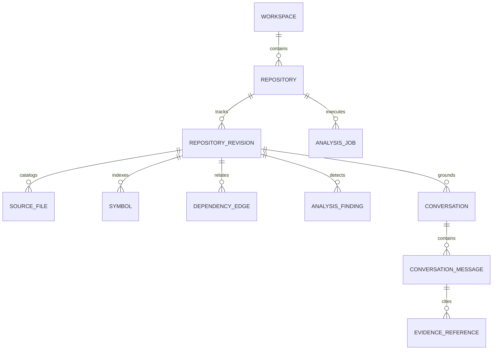

# DevMind AI: Database Design & Data Model

## Relational Schema Design
DevMind AI uses SQLAlchemy 2.0 with asynchronous engine drivers supporting SQLite (via `aiosqlite`) for local zero-config development and PostgreSQL for containerized deployments.

### Table Specifications

1. `workspaces`: Multi-tenant isolation boundary (`id`, `name`, `slug`, `created_at`).
2. `repositories`: Code repositories ingested (`id`, `workspace_id`, `name`, `source_type`, `remote_url`, `local_path`, `default_branch`, `is_analyzed`).
3. `repository_revisions`: Exact analyzed commit or snapshot (`id`, `repository_id`, `commit_hash`, `branch_name`, `summary_stats`).
4. `analysis_jobs`: Pipeline execution tracker (`id`, `repository_id`, `revision_id`, `status`, `current_stage`, `progress_percentage`, `stage_logs`).
5. `source_files`: Individual source files (`id`, `revision_id`, `path`, `extension`, `language`, `lines_of_code`, `layer`).
6. `symbols`: Extracted functions, classes, methods, interfaces (`id`, `file_id`, `name`, `qualified_name`, `kind`, `signature`, `docstring`, `start_line`, `end_line`, `return_type`).
7. `dependency_edges`: Explicit relationship edges (`id`, `revision_id`, `source_type`, `source_id`, `target_type`, `target_id`, `relationship`, `certainty`, `source_line`).
8. `analysis_findings`: Static linting and security issues (`id`, `revision_id`, `file_path`, `line_number`, `tool`, `rule_id`, `severity`, `message`, `is_dismissed`).
9. `conversations` & `conversation_messages`: Codebase Q&A chat history.
10. `evidence_references`: Verified citations tied to messages (`file_path`, `start_line`, `end_line`, `symbol_name`, `snippet`).
